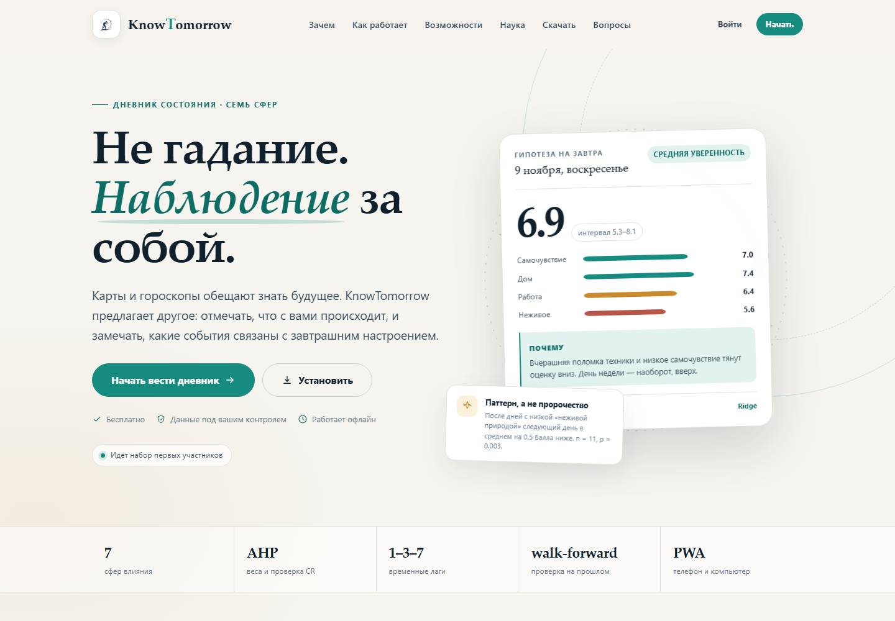
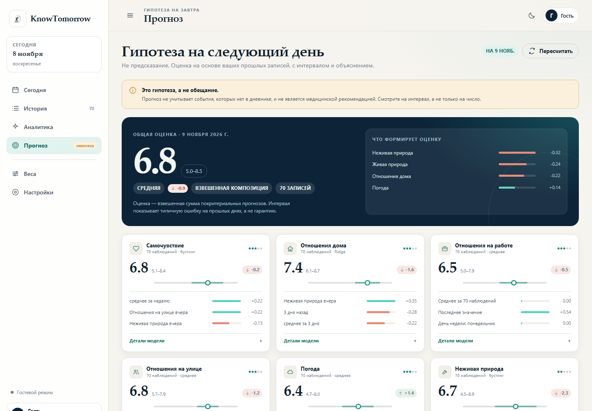
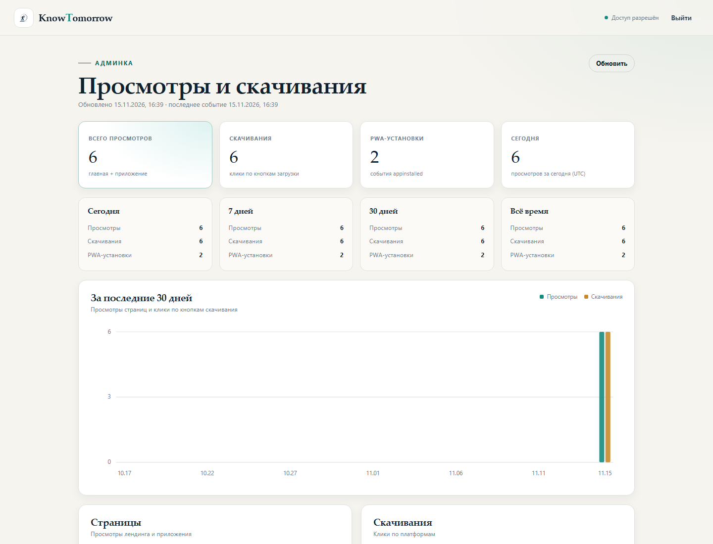

# KnowTomorrow 2.0.1

**Не гадайте, что будет завтра. Понимайте, что влияет на вас сегодня.**

KnowTomorrow — ежедневный трекер настроения и личный дневник наблюдений. Он
анализирует погоду, отношения дома и на работе, самочувствие и бытовые события,
показывает связи в ваших записях и формирует осторожные гипотезы о следующем дне.
Без карт, кофейной гущи и гороскопов. Только ваши данные, понятная аналитика и
честная неопределённость.

> Это инструмент саморефлексии, а не медицинский или диагностический прибор.
> Прогнозы — гипотезы, основанные на ваших прошлых записях.





---

## Что реализовано

### 1. Сайт с регистрацией и установкой

- Лендинг с описанием продукта, научного подхода, ограничений и загрузок.
- Регистрация и вход по email/паролю (scrypt, HttpOnly-сессии, SameSite=Lax).
- Синхронизация дневника между устройствами с версионированием и разрешением
  конфликтов.
- PWA: манифест, service worker, офлайн-оболочка, установка на Windows/macOS/
  Linux/Android/iOS.
- Страница загрузок и CI-сборки:
  - Electron-оболочка для Windows/macOS/Linux;
  - Capacitor-сборка Android APK;
  - PWA как основной способ установки без магазинов.
- Гостевой режим без регистрации: данные остаются в `localStorage`.
- Экспорт JSON/CSV, импорт, удаление аккаунта вместе с данными.
- Анонимная агрегация для популяционных приоров только по отдельному согласию
  и только при ≥ 5 участниках.
- Закрытая админка `/admin`: просмотры главной и приложения, клики по кнопкам
  скачивания, PWA-установки, график за 30 дней. Доступ по `ADMIN_TOKEN`,
  только обезличенные дневные счётчики.

### 2. Покритериальные прогнозы

Прогноз строится отдельно для **каждой из семи сфер** и для общей оценки:

- самочувствие;
- отношения дома;
- отношения на работе;
- отношения на улице;
- погода;
- неживая природа (техника, транспорт, поломки, бытовая среда);
- живая природа (животные, растения, насекомые).

Для каждого прогноза показываются:

- точка и интервал (типичная ошибка на прошлых днях);
- тренд относительно последнего значения;
- уверенность, ограниченная результатом проверки;
- метод (наивная, среднее, Ridge, градиентный бустинг, холодный старт);
- объяснение вкладов признаков;
- число наблюдений и метрики MAE/RMSE.

Общая оценка — взвешенная композиция покритериальных прогнозов. Это прозрачнее
отдельной «чёрной» модели и позволяет увидеть, какая сфера тянет оценку вверх
или вниз.

### 3. Рекомендации из задания

| Рекомендация | Что сделано |
|---|---|
| 1. Сместить акцент с прогноза на объяснение и паттерны | Лаговые корреляции 1–3 дня, различия групп «низкое/высокое», размер эффекта Коэна, p-значения и поправка Benjamini–Hochberg. В карточках — текст «что связано с чем», а не только число. |
| 2. Холодный старт и популяционные приоры | При < 5 наблюдениях используется среднее и анонимный популяционный ориентир; при 5–13 — климатология; персональные модели подключаются по мере данных. |
| 3. Управление ожиданиями | Дисклеймеры на лендинге, в приложении и в отчётах; «гипотеза», а не «предсказание»; показ наивного прогноза и честный вывод, если модель ему не уступает. |
| 4. Научная валидация | Walk-forward проверка, MAE/RMSE, парный t-тест; скрипт `scripts/research-report.mjs` для внутреннего отчёта по экспортам 10–20 пользователей; протокол в `docs/RESEARCH.md`. |
| 5. Технические улучшения | Ridge и градиентный бустинг вместо LSTM; признаки-лаги 1/2/3/7; проверка CR матрицы AHP; подсказка конкретной несогласованной тройки; выбор простой модели, если сложная не даёт выигрыша. |

---

## Быстрый старт

Требуется **Node.js 24+** (используется встроенный `node:sqlite`, без нативных
зависимостей и без `npm install`).

```bash
# из корня проекта
npm start
# http://localhost:8080
```

Лендинг: `http://localhost:8080/`  
Приложение: `http://localhost:8080/app`  
Демо без регистрации: `http://localhost:8080/app?demo=1`

### Админка

```bash
ADMIN_TOKEN="замените-на-длинный-случайный-токен" npm start
# http://localhost:8080/admin
```

Токен должен быть не короче 12 символов (лучше 32+ случайных байта). Без
`ADMIN_TOKEN` админка отвечает `503`, а остальной сайт работает как обычно.
Админка показывает обезличенные дневные счётчики: просмотры главной и
приложения, клики по кнопкам скачивания и PWA-установки. IP, cookie
пользователей и содержимое дневников в метриках не сохраняются.



### Демо-режим

Кнопка «Демо-данные» (или `?demo=1`) загружает 70 детерминированных
демонстрационных дней. Это **не реальные данные** и не выборка пользователей:
набор нужен, чтобы увидеть аналитику и формат прогноза.

### Тесты

```bash
npm test
# или отдельно
npm run test:analytics
npm run test:api
```

Тесты не требуют браузера и внешних зависимостей. Они проверяют AHP/CR, статистику,
холодный старт, покритериальные прогнозы, паттерны, слияние состояний, регистрацию,
сессии, конфликты версий, приоры, экспорт и удаление аккаунта.

---

## Структура

```
knowtomorrow/
├── server/                 HTTP-сервер без зависимостей
│   ├── index.mjs           запуск, статика, API
│   ├── api.mjs             REST-маршруты
│   ├── auth.mjs            scrypt, сессии, cookie, rate limit
│   ├── db.mjs              SQLite (node:sqlite)
│   ├── priors.mjs          анонимная агрегация
│   └── static.mjs          статика, CSP, кэширование
├── shared/                 код, общий для браузера и Node
│   ├── analytics.mjs       AHP, статистика, признаки, модели, бэктест
│   ├── app-model.mjs       схема состояния, веса, слияние
│   ├── constants.mjs       категории, RI, пресеты
│   ├── dates.mjs           календарь без DST-сюрпризов
│   └── demo.mjs            детерминированные демо-данные
├── public/
│   ├── index.html          лендинг
│   ├── app.html            приложение
│   ├── privacy.html        политика и условия
│   ├── css/                дизайн-система
│   ├── js/                 приложение, графики, API-клиент
│   ├── assets/             логотип и иконки PWA
│   ├── manifest.webmanifest
│   └── sw.js               service worker
├── tests/                  unit + API
├── scripts/                иконки, CDP-проверки, research-report
├── desktop/                Electron-оболочка
├── mobile/                 Capacitor-конфиг
├── docs/                   наука, API, деплой, упаковка, исследование
└── data/                   SQLite (не коммитится)
```

---

## Научный подход кратко

- **AHP Саати:** матрица парных сравнений, веса, λmax, CI, CR. При CR > 0.1
  пользователь видит конкретную тройку критериев, которую стоит пересмотреть.
- **Признаки:** лаги 1/2/3/7 дней, скользящие средние 3/7, день недели, перерыв
  в записях, контекст остальных сфер.
- **Модели:** наивная «завтра = сегодня», среднее, Ridge-регрессия,
  градиентный бустинг с маленькими деревьями.
- **Проверка:** walk-forward, только прошлые наблюдения; MAE/RMSE; парный
  t-тест; выбор простой модели, если сложная не даёт ощутимого выигрыша.
- **Паттерны:** корреляции с лагами и различия групп; q-значения
  Benjamini–Hochberg; формулировки «связь», а не «причина».
- **Холодный старт:** персонализация включается постепенно, а не имитируется
  на двух записях.

Подробности: [`docs/SCIENCE.md`](docs/SCIENCE.md).

---

## Деплой

Сервер не имеет внешних зависимостей, поэтому разворачивается где угодно, где
есть Node 24 и постоянный диск:

```bash
docker compose up -d --build
# http://localhost:8080
```

Для production:

- HTTPS обязателен;
- `COOKIE_SECURE=true`;
- `TRUST_PROXY=1` за обратным прокси;
- постоянный volume для `/data`;
- резервные копии SQLite.

Готовые варианты: `Dockerfile`, `docker-compose.yml`, `render.yaml`, `fly.toml`.
Полная инструкция: [`docs/DEPLOY.md`](docs/DEPLOY.md).

> GitHub Pages может отдавать только статику. Для регистрации и синхронизации
> нужен backend; PWA-оболочку можно кэшировать, но аккаунт требует сервер.

---

## Установка и сборки

- **PWA** — основной путь: кнопка «Установить» на лендинге или меню браузера.
- **Desktop** — Electron-оболочка открывает задеплоенный HTTPS-сайт; сборка через
  `desktop/` и `.github/workflows/desktop-release.yml`.
- **Android** — Capacitor + workflow `.github/workflows/android.yml`, APK в
  артефактах.
- **iOS** — PWA через Safari или Capacitor-проект в Xcode.

Подробности: [`docs/PACKAGING.md`](docs/PACKAGING.md).

---

## API

Кратко:

```
POST /api/auth/register
POST /api/auth/login
POST /api/auth/logout
GET  /api/auth/me
GET  /api/state
PUT  /api/state          (optimistic versioning, 409 при конфликте)
GET  /api/priors         (анонимные агрегаты, только при согласии)
GET  /api/account/export
PATCH /api/account
POST /api/account/delete
GET  /api/stats
GET  /api/health
```

Полная схема, коды ошибок и примеры: [`docs/API.md`](docs/API.md).

---

## Приватность и безопасность

- Пароли — scrypt с индивидуальной солью; в открытом виде не хранятся.
- Сессии — HttpOnly + SameSite=Lax; в production Secure.
- CSRF — проверка Origin для небезопасных методов + SameSite.
- CSP без `unsafe-inline`, без внешних CDN, без сторонней аналитики.
- Ограничение размера тела, rate limit, экранирование пользовательских строк.
- Данные дневника не используются для рекламы и не продаются.
- Анонимная агрегация — opt-in, только средние, порог ≥ 5 участников.
- Экспорт и удаление данных доступны пользователю.

Политика и условия: [`public/privacy.html`](public/privacy.html).

---

## Ограничения

- Мало данных: выводы нестабильны, особенно до 14–20 записей.
- Самоотчёты субъективны; связи не доказывают причинность.
- Модель не знает о событиях, которых нет в дневнике.
- Пропуски дней и нестационарность ухудшают прогноз.
- Выбор модели по walk-forward — оптимистичная оценка; для строгой валидации
  нужен отдельный holdout и предрегистрация.
- Нет email-верификации, восстановления пароля и OAuth — это следующий шаг.
- PWA-офлайн и локальные данные работают без сервера; аккаунт и синхронизация
  требуют сети.

---

## Лицензия

MIT. См. [`LICENSE`](LICENSE).
